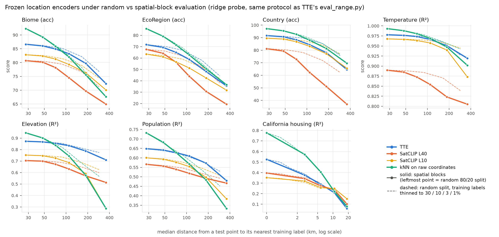
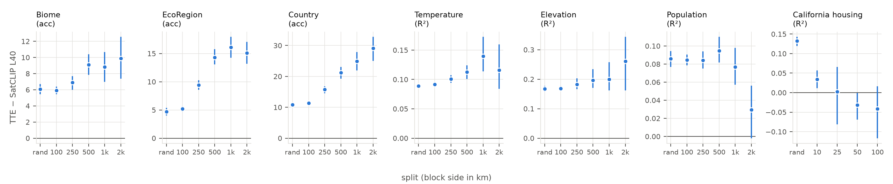
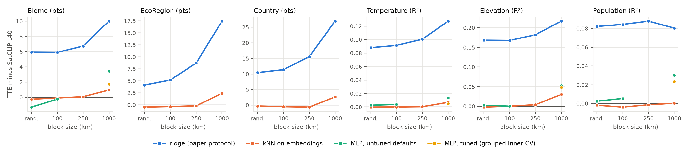
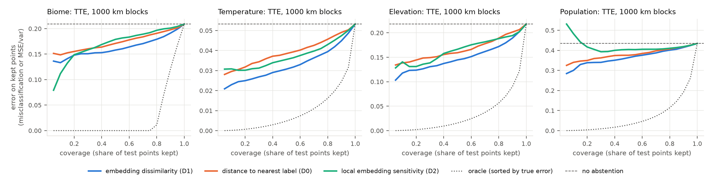

# Findings: frozen location encoders under spatial-block evaluation

Rohan Bali, 7–8 November 2026. Ongoing work. Every number below is generated by the scripts in `src/`, and the full tables are in `outputs/RESULTS_TABLES.md`.

## Summary

Under the linear probe used in TTE's own evaluation (`eval/eval_range.py`), TTE's lead over SatCLIP ViT16-L40 widens when whole regions are held out. Of the four tasks the pre-registered H1 named, it grows on three: Biome from +5.9 points on a random split to +10.0 at 1000 km blocks, Temperature from +0.088 to +0.127 R², and Elevation from +0.168 to +0.217 R², each positive on all 5 grid offsets. On Population it stays flat (+0.082 to +0.080).

Most of that gap depends on the readout. With a kNN or MLP probe on the same frozen embeddings, the two encoders are indistinguishable on random splits and blocks up to 250 km. TTE keeps a smaller lead, but it is consistent at 1000 km: +0.9 to +2.6 points on the classification tasks under kNN (+1.7 on Biome under a tuned MLP), and +0.005 to +0.048 R² on Temperature, Elevation and Population under a tuned MLP. Under the pre-registered rule (every grid offset, under both ridge and kNN), with the added requirement that the block-bootstrap CI exclude zero, "TTE beats SatCLIP L40 under 1000 km blocks" holds on 5 of 7 tasks.

The random split mostly measures interpolation. There, kNN on raw latitude/longitude beats every encoder read out by the linear probe, on every task.

## 1. Reproduction gate (E0): passed on 6 of 7 tasks

California Housing is the only task with exactly the paper's data. The paper's appendix reports a single 80/20 split with seed 42. With that seed I get TTE 0.536 and SatCLIP L40 0.404, against the paper's 0.532 and 0.400: the same +0.132 gap. Averaged over seeds 42–46, as `eval_range.py --n_seeds 5` does by default, I get 0.526 and 0.396. SatCLIP L10 averages 0.352, so the paper's SatCLIP row matches L40.

The other six tasks use labels rebuilt from public sources (Ecoregions2017, Natural Earth, WorldClim, GHS-POP), so their absolute values differ from the paper's. For example, on Biome I get 86.6 against the paper's 77.8. The pre-registered gate asked for the same TTE vs SatCLIP ordering and a gap of similar size. The ordering matches on six of seven tasks. It fails on EcoRegion, where the paper has SatCLIP ahead (69.3 against 67.4) and these labels put TTE ahead (71.8 against 67.6).

| Task | Paper: TTE − SatCLIP | Here: TTE − SatCLIP L40 (seeds 42–46) |
|---|---|---|
| Biome | +8.9 | +5.9 |
| EcoRegion | −1.9 | +4.1 |
| Country | +12.0 | +10.4 |
| Temperature | +0.121 | +0.088 |
| Elevation | +0.173 | +0.168 |
| Population | +0.106 | +0.082 |
| California Housing | +0.132 | +0.130 (+0.132 with seed 42) |

## 2. The random split measures lookup (H2)

On the random 80/20 split, kNN on raw coordinates beats every encoder read out by the paper's ridge probe, on every task:

| Task | kNN on coordinates | TTE |
|---|---|---|
| Biome | 92.3 | 86.6 |
| Country | 97.2 | 91.7 |
| Elevation | 0.946 | 0.872 |
| Housing | 0.777 | 0.526 |

On Housing, 60.1% of rows share their exact coordinates with another row, so the median distance to the nearest training label is 0 km.

Read out by kNN instead, TTE and SatCLIP L40 embeddings match coordinate kNN to within 0.5 points and 0.011 R² on every task. On a random split, any readout that can look up nearby labels does about as well as the best encoder.

Under blocks, coordinate kNN degrades fastest on the regression tasks and on Biome, and TTE overtakes it at about 250–500 km. On Country and EcoRegion, coordinate kNN stays ahead of TTE even at 2000 km.

*Figure 1. Score against the median distance from a test point to its nearest training label, under the ridge probe. Solid lines: the random split (leftmost point), then spatial blocks of increasing size. Dashed lines: the random split with training labels thinned to 30 / 10 / 3 / 1%, which reaches similar distances without holding out any region.*

## 3. Under blocks, the linear-probe lead grows, not shrinks (H1 not supported)

Gaps below are TTE minus SatCLIP L40 under the paper's ridge probe. Each is the mean over 5 grid offsets, and TTE is ahead on 5/5 offsets in every cell shown.

| Task | Random | 250 km | 1000 km |
|---|---|---|---|
| Biome | 5.9 | 6.7 | 10.0 |
| EcoRegion | 4.1 | 8.7 | 17.5 |
| Country | 10.4 | 15.6 | 27.0 |
| Temperature | 0.088 | 0.101 | 0.127 |
| Elevation | 0.168 | 0.182 | 0.217 |
| Population | 0.082 | 0.088 | 0.080 |

The result survives three robustness checks. The grid offsets were pre-registered; the hexagons and the wide grid were added later.

- Square blocks replaced by H3 hexagons.
- A wide ridge grid (α from 10⁻⁴ to 10⁴, chosen by grouped inner CV). The gaps change by at most 0.7 points or 0.007 R².
- All 5 grid offsets.

*Figure 2. TTE minus SatCLIP L40 under the ridge probe, by block side, for grid offset 0 with 95% block-bootstrap CIs. The tables report means over all 5 offsets, so their values differ slightly.*

**Exception: California Housing.** The lead is gone by 25 km blocks, and at 100 km both encoders score near or below zero R².

## 4. The lead depends on the readout (E3: kNN probe pre-registered, MLP probe added)

The same embeddings and the same folds, read out three ways (TTE minus SatCLIP L40):

| Task | Split | Ridge (paper) | kNN on embeddings | MLP, untuned defaults; tuned where noted |
|---|---|---|---|---|
| Biome | random | +5.9 | −0.3 | −1.3 |
| Biome | 1000 km | +10.0 | +0.9 (5/5) | +3.4 (3/3); tuned +1.7 (5/5) |
| EcoRegion | 1000 km | +17.5 | +2.4 (5/5) | |
| Country | 1000 km | +27.0 | +2.6 (5/5) | |
| Temperature | random | +0.088 | −0.000 | +0.003 |
| Temperature | 1000 km | +0.127 | +0.007 (5/5) | +0.014 (3/3); tuned +0.005 (4/5) |
| Elevation | random | +0.168 | −0.002 | +0.003 |
| Elevation | 1000 km | +0.217 | +0.030 (5/5) | +0.053 (3/3); tuned +0.048 (5/5) |
| Population | 1000 km | +0.080 | +0.000 (3/5) | +0.030 (3/3); tuned +0.023 (5/5) |

The (n/m) counts are offsets with TTE ahead. The untuned MLP was run on 5 tasks only, at random, 100 km and 1000 km, with 3 offsets. The tuned MLP was run at 1000 km only, on Biome, Temperature, Elevation and Population, with all 5 offsets.

**Tuned MLP (1000 km).** I re-ran the MLP with a small grid: hidden layers (256) or (512, 512), times L2 α 10⁻⁴ or 10⁻¹. The setting was chosen by a 3-fold inner CV grouped by block, on training folds only, across all 5 offsets.

| Task | TTE | SatCLIP L40 | Gap, mean of 5 offsets | Range over offsets | Offset 0: gap [95% CI] | Offsets ahead | Untuned gap, same 3 offsets |
|---|---|---|---|---|---|---|---|
| Biome | 81.0 | 79.2 | **+1.7** | +1.3 to +2.4 | +1.7 [0.5, 2.8] | 5/5 | +3.4 |
| Temperature | 0.970 | 0.966 | **+0.005** | −0.000 to +0.007 | +0.006 [0.003, 0.010] | 4/5 | +0.014 |
| Elevation | 0.854 | 0.805 | **+0.048** | +0.032 to +0.062 | +0.062 [0.037, 0.101] | 5/5 | +0.053 |
| Population | 0.621 | 0.598 | **+0.023** | +0.011 to +0.030 | +0.027 [0.013, 0.042] | 5/5 | +0.030 |

- **Every gap shrinks with tuning, and every one stays positive.** Tuning helps SatCLIP L40 more than TTE. On the 3 offsets both runs share, tuning raised SatCLIP L40 by 1.9 points on Biome and by 0.012, 0.006 and 0.003 R² on Temperature, Elevation and Population. It raised TTE by 0.1 points and by 0.005, 0.003 and −0.001 R².
- **Temperature is the weakest.** The fifth offset is a tie (−0.00002 R²), and the mean gap is 0.005 R² on a task where both encoders score about 0.97.
- **SatCLIP L40 mostly chose the largest network**, (512, 512): in 25/25 outer folds on Biome and Temperature, 24/25 on Population and 22/25 on Elevation. A larger grid could narrow the gaps further. TTE's choice varied more on Elevation and Population, where it took (512, 512) in 15/25 and 18/25 folds.
- **Early stopping.** The MLP's early-stopping split is a random 10% of each training fold, not grouped by block. This is the same for both encoders.

- **Near labels** (random split, 100 km and 250 km blocks), kNN puts the two encoders within 0.7 points (0.004 R²) of each other on every global task. SatCLIP L40 is slightly ahead more often than not.
- **At 1000 km**, TTE is ahead on average under every probe that was run on Biome, EcoRegion, Country, Temperature and Elevation. The MLP was run on Biome, Temperature and Elevation, not on EcoRegion or Country. The pre-registered rule uses ridge and kNN. Under both, each of these 5 tasks is positive on every offset, with a block-bootstrap CI above zero, so the rule is met on these 5 tasks. The tuned MLP agrees: it is positive on every offset, except for one tie on Temperature.
- **The rule is not met on Population or Housing.** On Population, kNN is ahead on only 3/5 offsets, even though ridge and the tuned MLP (+0.023 R², 5/5) favour TTE. On Housing, which covers one state and so is tested at up to 100 km blocks, TTE is behind on most offsets.
- **Why the ridge gap is large.** SatCLIP L40 loses 9–26 points of accuracy (0.06–0.25 R²) when a linear head replaces kNN. TTE loses 0.7–14 points (at most 0.08 R²). Most of the ridge gap therefore reflects how well a global linear map can read each embedding, not a difference in what the embeddings contain. This is also why the distance-vs-region decomposition (`outputs/RESULTS_TABLES.md`) assigns SatCLIP L40 a region effect 3–4× larger than TTE's under ridge: it measures a linear readout extrapolating into held-out regions.

*Figure 3. The same gap under each readout, as means over offsets. Under ridge it widens with block size on five of the six tasks. Under kNN it is near zero at the random split and at 100 and 250 km blocks, and positive at 1000 km. kNN was not run at 500 or 2000 km.*

## 5. At long range, embedding neighbours beat geographic neighbours

At 1000 km blocks, kNN in embedding space beats kNN on coordinates for both encoders:

| Task | TTE embeddings | SatCLIP L40 embeddings | Coordinates |
|---|---|---|---|
| Elevation (R²) | 0.796 | 0.766 | 0.576 |
| Temperature (R²) | 0.968 | 0.961 | 0.947 |
| Biome (acc) | 80.4 | 79.5 | 75.6 |
| EcoRegion (acc) | 54.5 | 52.1 | 50.5 |

The embeddings carry environmental similarity that transfers across regions beyond what proximity gives. Country is the exception (81.4 for coordinates against 79.2 for TTE), as expected for an administrative label.

## 6. Positivity in label space (H3 supported)

Under blocks, some test points belong to classes that never appear in the training folds:

- **EcoRegion.** The share of test points whose class was seen in training drops from 89.3% at 1000 km to 70.2% at 2000 km. At 2000 km, TTE scores 50.6% on supported points against 35.5% overall.
- **Country.** The share is 88.4% at 2000 km.

So part of the accuracy drop under large blocks cannot be recovered by any encoder.

## 7. Label-free trust scores (E2, H4 partly supported)

I compared two scores for ranking per-point error without labels:

- **D0:** distance to the nearest training label.
- **D1:** a dissimilarity index computed in embedding space, in the style of Meyer & Pebesma.

There are 36 cases: 6 global tasks × 2 block sizes (500 and 1000 km) × 3 encoders. In 24 of them, D1 gives the larger risk–coverage gain with a CI above zero. 11 are inconclusive. D1 is worse in 1: TTE on EcoRegion at 500 km.

By encoder, D1 wins 7/12 cases for TTE, 8/12 for SatCLIP L40 and 9/12 for SatCLIP L10. For TTE, D1 is clearly better on Temperature and Elevation (AURC gain 0.31–0.47 against 0.18–0.32) but not on Country or EcoRegion. Figure 4 shows the curves.

*Figure 4. Risk–coverage for TTE at 1000 km blocks. Each curve sets aside the test points a label-free score trusts least, and plots the error on the points kept. Lower is better. The dotted line is the oracle, which sorts by the true error.*

## 8. Learned-site density (H5 not supported)

Per held-out 500 km block, I compared the number of TTE learned sites within 500 km with TTE's advantage on that block. The association is negative on the classification tasks (Spearman −0.15 to −0.21, CIs below zero): TTE's ridge advantage is larger where sites are sparse. On the regression tasks it is weak and mostly null; Population at 1000 km is +0.15 [0.01, 0.27]. This is less surprising given §9: each location mixes about 80 sites, so the density of nearby sites is a weak description of what the model does locally.

## 9. Where does TTE's linear readability come from? (E4, added after E3, not pre-registered)

TTE's location encoder computes, in order:

1. Soft-Voronoi weights over 4,096 learned sites, `w = softmax(τ_k⟨g, s_k⟩)`.
2. The site embedding `w @ E` (384-d).
3. Semantic-register attention plus a skip connection (512-d).
4. A residual MLP, followed by L2 normalization. This is the released embedding.

I cached stages 2 and 3 and ran the same ridge probe on each, with the same folds. Recomputing the final embedding this way matches the cached one exactly.

**The soft assignment is very soft.** With the learned τ (41–52), a location's effective number of sites (1/Σw²) has median 80 (10th–90th percentile 30–152). The largest single weight is about 0.05.

| Task | Split | Site embedding | + registers | + MLP (released) | SatCLIP L40 | kNN on released TTE |
|---|---|---|---|---|---|---|
| Biome | random | 79.7 | 80.4 | 86.6 | 80.7 | 92.5 |
| Biome | 1000 km | 73.1 | 74.8 | 79.7 | 69.7 | 80.4 |
| EcoRegion | random | 53.0 | 55.4 | 71.8 | 67.6 | 85.8 |
| EcoRegion | 1000 km | 34.1 | 36.3 | 48.1 | 30.7 | 54.5 |
| Country | random | 85.9 | 86.4 | 91.7 | 81.2 | 96.8 |
| Country | 1000 km | 74.7 | 75.3 | 78.1 | 51.1 | 79.2 |
| Temperature | random | 0.961 | 0.965 | 0.978 | 0.890 | 0.994 |
| Temperature | 1000 km | 0.942 | 0.947 | 0.951 | 0.823 | 0.968 |
| Elevation | random | 0.659 | 0.710 | 0.872 | 0.704 | 0.950 |
| Elevation | 1000 km | 0.500 | 0.554 | 0.788 | 0.571 | 0.796 |
| Population | random | 0.568 | 0.578 | 0.648 | 0.566 | 0.730 |
| Population | 1000 km | 0.473 | 0.486 | 0.572 | 0.492 | 0.548 |

- **The residual MLP head contributes most of TTE's linear readability.** On the random split it adds:
  - +16.4 points on EcoRegion
  - +6.2 points on Biome
  - +0.162 R² on Elevation
  - +0.224 R² on Housing
- **The register stage adds little under a linear probe:** +0.5 to +2.4 points, or +0.004 to +0.054 R². This says nothing about the registers' role in image alignment during training, which I did not test.
- **On the random split, the bare site embedding is mixed against SatCLIP L40** under ridge. It is close on Biome and Population, lower on EcoRegion (53.0 against 67.6), Elevation and Housing, and higher on Country and Temperature.
- **At 1000 km, the bare site embedding already beats SatCLIP L40's final embedding** under ridge on Biome (73.1 against 69.7), EcoRegion, Country (74.7 against 51.1) and Temperature. It does not on Elevation or Population. So a linear readout of the smooth site mixture extrapolates better than a linear readout of SatCLIP L40, before TTE's MLP is applied.
- **At 1000 km, TTE's ridge score is close to its own kNN score** (Biome 79.7 against 80.4; Elevation 0.788 against 0.796). Far from labels, the released embedding is close to fully linearly readable. SatCLIP L40 is not.

This is descriptive. It locates where readability appears inside TTE, but it is not an ablation: no model was retrained.

## Hypothesis scorecard

| | Hypothesis | Outcome |
|---|---|---|
| H1 | All encoders score lower as blocks grow; TTE's lead shrinks | **First half supported, second half not.** Under ridge, every encoder's score falls steadily from the random split to 2000 km blocks on all four H1 tasks (Biome, Temperature, Elevation, Population), except raw xyz on Population, which stays near zero R². TTE's lead does not shrink: under ridge it grows on Biome, Temperature and Elevation and stays flat on Population. Under kNN it is about zero at the random split and at 100 and 250 km, and positive at 1000 km (kNN was not run at 500 or 2000 km). Housing, not an H1 task, is the exception: there the lead vanishes by 25 km. |
| H2 | Coordinate kNN is competitive on random splits and degrades fastest | **Supported for the first half.** The second half holds on the regression tasks and Biome; on Country and EcoRegion, coordinate kNN stays ahead. |
| H3 | Class-support ceiling explains part of the block drop | **Supported.** |
| H4 | Embedding dissimilarity ranks error better than label distance | **Partly supported** (24/36 cases, 1 reversed). |
| H5 | TTE's advantage rises with site density | **Not supported.** The association is reversed on classification. |

## Caveats

- Labels for six of the seven tasks are rebuilt from public sources. Only Housing uses the paper's exact data.
- **What was pre-registered.** `PREREGISTRATION.md` was written on 7 November, before any spatial-block result existed. That is my own statement: the file was saved minutes before the first random-split run, and no outside timestamp can show the order. It fixes H1–H5, the block design (sizes and 5 offsets), the ridge probe, the kNN-on-embeddings check, the all-offsets decision rule and the block bootstrap. Added later: the MLP probes (untuned and tuned), the wide-α ridge grid, H3 hexagons, thinned labels (E1b), the sensitivity score D2, the CI-excludes-zero requirement, and E4.
- **Population labels were changed once.** The first build used point samples of 30″ GHS-POP counts. On the first random-split run every encoder scored R² ≈ 0.3, so I rebuilt the target as 5′ area averages (log1p) before any block result was computed. All reported Population numbers use the rebuilt target.
- The main E3 MLP probe is a single, untuned sklearn configuration run on 5 tasks with 3 offsets. The tuned MLP (§4) picks its size and α by an inner CV grouped by block, but only at 1000 km and on 4 tasks, and SatCLIP L40 mostly chose the edge of that grid. kNN on embeddings chooses k from {3, 10, 30} by a 3-fold inner CV on the training folds; kNN on coordinates chooses from {1, 3, 10, 30}. Neither kNN inner CV is grouped by block, and no MLP's early-stopping split is. These ungrouped choices tune for interpolation, the same way for both encoders.
- **Leakage checks.** Test labels never enter a probe: `fit_predict` takes no test labels. Scalers, target standardization and hyperparameter search are fit on training folds only. On all 175 block splits (7 tasks × 5 sizes × 5 offsets, 875 folds), no block appears in both training and test, every point is predicted exactly once, and at the finest block size no exact coordinate is shared across a fold.
- **Blocks hold out labels, not pretraining data.** Both encoders were pretrained contrastively on global Sentinel-2 imagery, so a held-out block is a region with no downstream labels, not a region the encoder has never seen.
- **Block sides are in projected km.** The grid is equal-area, so every block has the same area, but away from the equator blocks narrow east–west and stretch north–south: at 60° latitude a 1000 km block is about 500 km wide and 2000 km tall on the ground. H3 hexagons, which are close to regular on the ground, give the same conclusions (§3).
- Block-bootstrap CIs come from grid offset 0. Sign counts cover all offsets. The E2 CIs use 500 resamples, not the pre-registered 1,000; the score-gap CIs use 1,000.
- Housing results at blocks of 100 km and above rest on few blocks with R² near or below zero, so I treat them as uninformative.

## Not done

- **The paper's exact labels.** The RANGE evaluation CSVs are not public, so six of the seven tasks use rebuilt labels.
- **Tuned MLP everywhere.** It was run only at 1000 km and on Biome, Temperature, Elevation and Population, with a 4-point grid whose largest network SatCLIP L40 mostly chose.
- **Grouped inner CV for kNN.** k is chosen by an ungrouped inner CV.
- **Other location encoders.** Only TTE, SatCLIP (L10, L40), a fixed spherical-harmonic basis and raw coordinates were compared.
- **The kNN distance.** kNN on embeddings uses Euclidean distance after min–max scaling, with TTE's embeddings L2-normalized and SatCLIP's raw, as in the ridge protocol. Cosine distance or unscaled embeddings were not tried.
