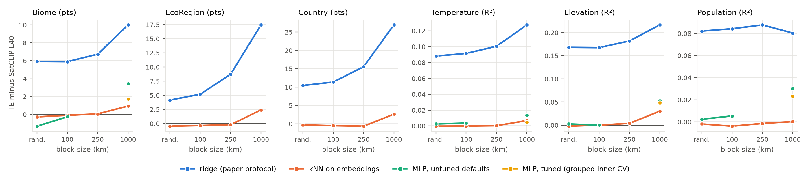

# Spatial-block evaluation of frozen location encoders

[](https://github.com/rohanbalixz/location-encoders-spatial-cv/actions/workflows/tests.yml)
[](requirements.txt)
[](LICENSE)
[](PREREGISTRATION.md)

**Does a location encoder's advantage survive when whole regions are held out?**

Location encoders such as TTE and SatCLIP are usually compared on random 80/20 splits. There, the median test point is 28 km from a training label. This repo re-runs the downstream protocol of *Tessellating the Earth* (TTE; Cher et al., ECCV 2026), with the released `MVRL/TTE` weights and the probe settings of TTE's own `eval/eval_range.py`. The main change is the split: random splits become spatial-block cross-validation, and under 1000 km blocks the median test point is 186 km from a training label. The same frozen embeddings are also read out by kNN and MLP probes besides the paper's ridge, to separate what the embeddings contain from how easily a linear head can read them.

Rohan Bali · ongoing work, November 2026

## Key results

1. **Under TTE's own linear probe, TTE's lead over SatCLIP ViT16-L40 grows when regions are held out.** The pre-registered hypothesis H1 predicted the opposite. Of the four tasks it named, the lead grows on three: on Elevation from +0.168 R² on a random split to +0.217 at 1000 km blocks, and on Biome from +5.9 to +10.0 points. On Population it stays flat (+0.082 to +0.080).
2. **Most of that lead comes from the readout.** Read out by kNN instead, the two encoders tie on random splits. At 1000 km TTE keeps a smaller lead that is consistent across grid offsets. "TTE beats SatCLIP L40 under 1000 km blocks" meets the pre-registered rule on 5 of 7 tasks.
3. **The random split mostly measures lookup.** kNN on raw latitude and longitude beats every encoder read out by the linear probe, on every task. On Elevation, for example, it scores R² 0.946 against TTE's 0.872.

**TTE minus SatCLIP ViT16-L40**: same frozen embeddings, same folds, different readouts.

| Task | Random · ridge | Random · kNN | 1000 km · ridge | 1000 km · kNN | 1000 km · tuned MLP |
|---|---:|---:|---:|---:|---:|
| Biome (accuracy, points) | +5.9 | −0.3 | +10.0 | +0.9 | +1.7 |
| EcoRegion (accuracy, points) | +4.1 | −0.5 | +17.5 | +2.4 | — |
| Country (accuracy, points) | +10.4 | −0.3 | +27.0 | +2.6 | — |
| Temperature (R²) | +0.088 | 0.000 | +0.127 | +0.007 | +0.005 |
| Elevation (R²) | +0.168 | −0.002 | +0.217 | +0.030 | +0.048 |
| Population (R²) | +0.082 | −0.002 | +0.080 | 0.000 | +0.023 |

<sub>Means over 5 seeds (random) or 5 grid offsets (blocks). Ridge is TTE's `eval_range.py` probe. Every 1000 km gap is positive on all 5 offsets, except Population under kNN (3/5) and Temperature under the tuned MLP (4/5, the fifth a tie). The tuned MLP chooses its size and L2 penalty by an inner CV grouped by block; — means not run. California Housing covers one state and is tested only up to 100 km blocks; see FINDINGS.md.</sub>



<sub>The same gap as a function of block size. Under ridge (blue) it widens with block size on five of the six tasks. Under kNN (orange) it is near zero at the random split and at 100 and 250 km blocks, and positive at 1000 km; kNN was not run at 500 or 2000 km.</sub>

Full write-up, hypothesis scorecard and caveats: **[FINDINGS.md](FINDINGS.md)**. Every table, with 95% block-bootstrap CIs: **[outputs/RESULTS_TABLES.md](outputs/RESULTS_TABLES.md)**.

## Pre-registration

[PREREGISTRATION.md](PREREGISTRATION.md) was written before any spatial-block result existed. It fixes:
- the hypotheses (H1–H5),
- the block design,
- the ridge and kNN probes,
- the decision rule: a finding must hold on all 5 grid offsets, under both probes,
- the block bootstrap.

Everything else was added afterwards and is labelled as such. Hypotheses that failed are reported as failed.

| ID | Question | Pre-registered | Results |
|---|---|---|---|
| E0 | Does the paper's random-split ordering reproduce? (gate) | yes | `results_e0_random.csv`, `results_e0_pop.csv` |
| E1 | How do scores and the TTE − SatCLIP gap change under blocks? (H1–H3) | yes | `results_e1_block.csv` |
| E1b | The same label distances from thinned labels, with no region held out | no | `results_e1b_sparse.csv` |
| E2 | Can a label-free score predict where an encoder fails? (H4, H5) | yes; sensitivity score D2 added | `e2_*.csv` |
| E3a | Does the lead survive a kNN readout? | yes | `results_e3_knnemb.csv` |
| E3b | Does it survive an MLP readout, untuned and tuned by grouped inner CV? | no | `results_e3_mlp*.csv` |
| E3c | Do H3 hexagons give the same answer as square blocks? | no | `results_e3_h3.csv` |
| E3d | Does a wide ridge α grid, chosen by grouped inner CV, change the gaps? | no | `results_e3_ridgewide.csv` |
| E4 | Which stage of TTE carries its linear readability? | no | `results_e4_*.csv` |

## Protocol

**Held fixed, exactly as in `external/TTE/eval/eval_range.py`:**
- TTE embeddings are L2-normalized (the script's default); SatCLIP embeddings are used raw, as in RANGE.
- The probe is `MinMaxScaler`, then `RidgeClassifierCV(alphas=(0.1, 1, 10), cv=10)` or `RidgeCV(alphas=(0.1, 1, 10), cv=3)`.
- The random split is 80/20 with seeds 42–46, averaged, as `eval_range.py --n_seeds 5` does by default. The paper's appendix reports a single split with seed 42; per-seed scores are in `outputs/results_e0_*.csv`.

**Changed:**
- **Spatial blocks.** 5-fold `GroupKFold` over square blocks on a Lambert cylindrical equal-area grid. Block sides are 100 / 250 / 500 / 1000 / 2000 km for the global tasks and 10 / 25 / 50 / 100 / 200 km for California, each with 5 random grid offsets.
- **One distance axis.** Every protocol is also placed on the median great-circle distance from a test point to its nearest training label.
- **What a block holds out.** Downstream labels, not pretraining data. Both encoders were pretrained on global Sentinel-2 imagery, so a held-out block is a region with no labels, not one the encoder has never seen.
- **Block geometry.** Sides are in projected km on an equal-area grid. Every block has the same area, but away from the equator blocks narrow east–west and stretch north–south: at 60° latitude a 1000 km block is about 500 × 2000 km on the ground. H3 hexagons, close to regular on the ground, give the same conclusions (E3c).
- **Readouts.** kNN and MLP probes run on the same embeddings and folds as ridge. Scalers, target standardization and hyperparameter search are fit on training folds only.
- **Uncertainty.** 95% CIs come from a bootstrap over test blocks, never from point-level intervals. The score gaps use 1,000 resamples, as pre-registered, and the E2 trust scores use 500.

**Baselines:**
- SatCLIP ViT16-L40 and ViT16-L10.
- A fixed spherical-harmonic basis (L = 10, no learning).
- Raw xyz.
- kNN on raw coordinates (haversine, k chosen by inner CV). This shows how much of a benchmark is lookup.

**Leakage checks.** `src/check_leakage.py` verifies the exact splits used for the results. No block appears on both the training and test side of a fold, every point is tested exactly once, and at the finest block size no exact coordinate is shared across a fold. The unit tests in `tests/` check the same properties on synthetic data, and also that every probe is fit on training data only: no test point's prediction depends on the other test points. A scaler fit on training plus test data, or folds that ignore the blocks, makes them fail.

## Data and deviations from the paper

The RANGE evaluation CSVs are not public, so labels are rebuilt from public sources (`src/build_data.py`). The six global tasks are drawn from one sample of 50,000 points, uniform on land (latitude > −60°). Each task keeps the points that have a label, which leaves 48,990 to 50,000 per task. Absolute numbers therefore differ from the paper's Table 1. The reproduction gate (E0) required the same ordering and gaps of similar size. The ordering matches on six of seven tasks. On EcoRegion the paper has SatCLIP ahead (69.3 against 67.4), while these labels put TTE ahead (71.8 against 67.6). California Housing, the one task with identical data, reproduces closely: averaged over seeds 42–46, TTE scores 0.526 and SatCLIP L40 0.396, against the paper's 0.532 and 0.400. The gap ranges from +0.123 to +0.135 across seeds, against the paper's +0.132.

| Task | Source here | RANGE's source |
|---|---|---|
| Biome, EcoRegion | RESOLVE Ecoregions 2017 | same |
| Country | Natural Earth 10m admin-0 | — |
| Temperature | WorldClim 2.1 BIO1, 10′ | Hooker et al. 2018 |
| Elevation | WorldClim 2.1 elevation, 10′ | Rolf et al. 2021 |
| Population | GHS-POP 2020, area-averaged to 5′, log1p | Rolf et al. 2021 |
| California housing | scikit-learn (1990 census) | same |

The Population target was rebuilt once. Point samples of 30″ counts gave R² ≈ 0.3 for every encoder on the first random-split run, so the target was changed to 5′ area averages. That happened before any block result was computed.

## Reproduce

The results were produced on macOS (Apple M3 Pro) with Python 3.11. Everything runs on a CPU.

```bash
git clone https://github.com/rohanbalixz/location-encoders-spatial-cv && cd location-encoders-spatial-cv
python3.11 -m venv .venv && source .venv/bin/activate
pip install -r requirements.txt
git clone https://github.com/mvrl/TTE external/TTE && git -C external/TTE checkout 2bce5e6
```

The next step downloads the label sources and SatCLIP checkpoints, about 0.9 GB in total. The TTE weights download from Hugging Face (`MVRL/TTE`) on first use, and California Housing comes through scikit-learn.

```bash
get() { mkdir -p "data/raw/$1" && curl -fsSL -o "data/raw/$1/${2##*/}" "$2" && { case "$2" in *.zip) unzip -q -o "data/raw/$1/${2##*/}" -d "data/raw/$1";; esac; }; }
get ecoregions     https://storage.googleapis.com/teow2016/Ecoregions2017.zip
get ne_land        https://naciscdn.org/naturalearth/10m/physical/ne_10m_land.zip
get ne_countries   https://naciscdn.org/naturalearth/10m/cultural/ne_10m_admin_0_countries.zip
get worldclim_bio  https://geodata.ucdavis.edu/climate/worldclim/2_1/base/wc2.1_10m_bio.zip
get worldclim_elev https://geodata.ucdavis.edu/climate/worldclim/2_1/base/wc2.1_10m_elev.zip
get ghs_pop        https://jeodpp.jrc.ec.europa.eu/ftp/jrc-opendata/GHSL/GHS_POP_GLOBE_R2023A/GHS_POP_E2020_GLOBE_R2023A_4326_30ss/V1-0/GHS_POP_E2020_GLOBE_R2023A_4326_30ss_V1_0.zip
get satclip_ckpt   https://huggingface.co/microsoft/SatCLIP-ViT16-L40/resolve/main/satclip-vit16-l40.ckpt
get satclip_ckpt   https://huggingface.co/microsoft/SatCLIP-ViT16-L10/resolve/main/satclip-vit16-l10.ckpt
```

Then run everything, or copy single steps from the script:

```bash
N_JOBS=8 ./scripts/reproduce.sh
```

- **Runtime.** The full run takes about 6.5 hours with 10 workers. Most of that is the kNN probe (1.7 h) and the tuned MLP (3.3 h).
- **What is committed.** The scores behind every table are in `outputs/results_*.csv`.
- **What the runs regenerate.** The CIs and E2 also need the per-point predictions in `outputs/points/` (318 MB, not committed).
- **Column definitions.** [`outputs/README.md`](outputs/README.md) describes every results file and column.

### Tests

The unit tests need no data and run in about 5 seconds:

```bash
pip install -r requirements-test.txt
ruff check . && pytest
```

They run on every push through GitHub Actions.

## Repository layout

```
├── PREREGISTRATION.md      hypotheses and decision rules, written before any block result
├── FINDINGS.md             results, figures, hypothesis scorecard, caveats
├── scripts/reproduce.sh    every run, in order
├── src/
│   ├── build_data.py       rebuild the seven tasks from public sources
│   ├── encoders.py         one interface to TTE, SatCLIP, spherical harmonics and xyz
│   ├── spatial_cv.py       splits (random, blocks, H3, thinned) and probes (ridge, kNN, MLP)
│   ├── diagnostics.py      E2: label-free trust scores and site density
│   ├── tte_layers.py       E4: intermediate TTE stages
│   ├── check_leakage.py    checks on the exact splits and saved predictions
│   ├── analyze.py, analyze_e3.py, figures_extra.py   tables and figures
│   └── vendor/satclip_le/  SatCLIP location encoder (MIT, Microsoft)
├── tests/                  split and probe properties on synthetic data
├── outputs/
│   ├── README.md           what every results file and column means
│   ├── RESULTS_TABLES.md   every table, with block-bootstrap CIs
│   ├── results_*.csv       one row per task × encoder × probe × split
│   └── figures/
├── requirements.txt        pinned versions used for the results
├── requirements-test.txt   minimal environment for the tests
└── pyproject.toml          lint and test configuration
```

## Citation

If this evaluation is useful, please cite the TTE paper, and this repository if you use its splits or results.

```bibtex
@inproceedings{cher2026tte,
  title     = {Tessellating the Earth: Learnable Spherical Voronoi Partitions for Location Encoding},
  author    = {Cher, Daniel and Iqbal, Hamza and Xing, Eric and Wei, Brian and Jacobs, Nathan},
  booktitle = {European Conference on Computer Vision (ECCV)},
  year      = {2026}
}

@misc{bali2026spatialcv,
  title        = {Spatial-block evaluation of frozen location encoders},
  author       = {Bali, Rohan},
  year         = {2026},
  howpublished = {\url{https://github.com/rohanbalixz/location-encoders-spatial-cv}},
  note         = {Ongoing work}
}
```

## Acknowledgements

- **TTE.** Model and evaluation code by Cher, Iqbal, Xing, Wei and Jacobs (ECCV 2026, MIT license).
- **SatCLIP.** By Klemmer et al. (AAAI 2025, MIT license). Its location encoder is vendored in `src/vendor/satclip_le` with its license.
- **RANGE.** The evaluation protocol follows RANGE (Dhakal et al., CVPR 2025).

This repo only extends their evaluation. The models and their results belong to their authors. Corrections and questions are welcome as GitHub issues.

## License

MIT for the code in this repo; see [LICENSE](LICENSE). The vendored SatCLIP location encoder keeps its own MIT license (Microsoft Corporation): [src/vendor/satclip_le/LICENSE](src/vendor/satclip_le/LICENSE).
